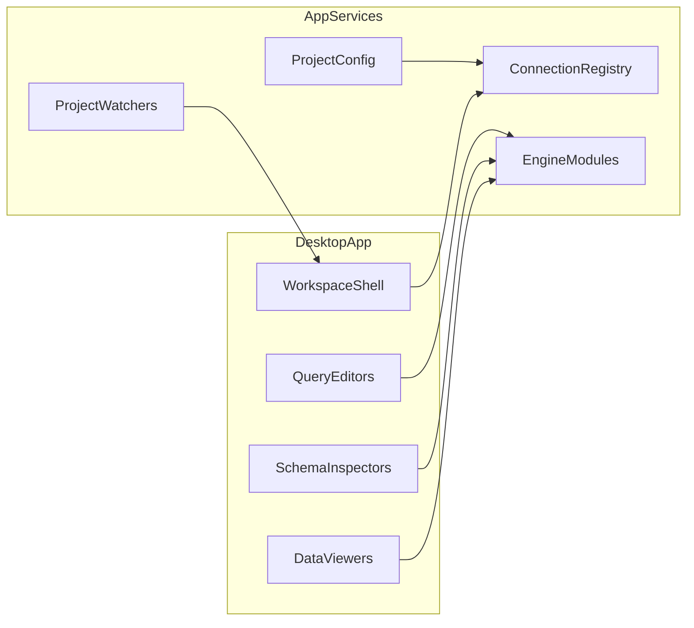

# Based - Architecture

This document captures the current production architecture for `based`.

## Product thesis

A **git-friendly**, **local-first** desktop database client for **Postgres, MongoDB, and SQLite**.

The project model is centered on a committed `.based/` folder:

- `project.toml` — project manifest and optional `[settings]` (committed)
- `connections/**/*.toml` — connection definitions (committed)
- `queries/**/*.toml` — saved queries with `[target]` (committed)
- `.env` — local secrets (git-ignored)
- `state/` — per-user state: favorites, active environment (git-ignored)
- `local/` — run history and other machine-local data (git-ignored)

## App runtime

The desktop app is **pure Rust** and lives in `apps/desktop`.

- UI: `gpui-kit` (GPUI + styled components)
- Async runtime bridging: Tokio via `db.rs`
- Data engines: SQLx-backed SQL engines and MongoDB driver
- Windowing: native multi-window behavior through GPUI app/window primitives



## Repository layout

```text
based/
├── apps/
│   └── desktop/          # GPUI binary — panels, workspace chrome, engine UI
├── crates/
│   ├── based-core/       # Shared types, session JSON, connection error taxonomy
│   ├── based-project/    # Parse/load/validate the .based/ format (no UI)
│   ├── based-query/      # History, saved queries, variables, SQL helpers
│   ├── based-postgres/   # Postgres config + sqlx execution (no UI)
│   ├── based-sqlite/     # SQLite config + sqlx execution (no UI)
│   ├── based-mongo/      # MongoDB config + document mutations (no UI)
│   ├── based-ssh/        # SSH local-forward tunnel in front of an engine
│   ├── based-storage/    # SQLite WAL metadata store + keychain secret boundary
│   └── based-workspace/  # Workspace/collection/environment models + template resolution
├── docs/
├── .based/
├── Cargo.toml
└── mise.toml
```

**Crate dependency rule:** `based-core` has no sqlx/GPUI. `based-query` and `based-workspace` depend on `based-core`. `based-project` owns parsing/loading of the `.based/` format. `based-ssh` provides tunnels used by engine connections. `based-storage` owns local SQLite metadata (WAL) and OS keychain secrets. Engine crates (`based-postgres`, `based-sqlite`, `based-mongo`) hold sqlx/driver logic only. `desktop` depends on all of them and owns GPUI entities (`ConnectionRegistry`, connection panels).

## Desktop module layers

`apps/desktop/src/` is organized by responsibility (UI shell; domain logic lives in `crates/*` where noted):

| Layer | Path | Role |
|-------|------|------|
| Project | `project/` | `.based/` discovery, file watching, variable resolution; parsing is in `crates/based-project` |
| Connection | `connection/` | Registry, open/close lifecycle — minimal engine tagging |
| Engines | `postgres/`, `sqlite/`, `mongodb/` | Drivers, schema, execution, engine panels |
| Workspace | `workspace/` | `Workspace` entity, tabs (`tabs/`), dock, `connection_tree/`; per-engine `tab_dispatch` lives in each engine module |
| Chrome | `workspace/chrome/` | Title bar, status bar, shell layout, GPUI overlay stack |
| Widgets | `widgets/` | Reusable panel UI (tables, editors, filters) |
| App | `app/` | Globals, actions, prefs, keybindings |

**Chrome dependency rule:** `workspace/chrome/` may use `widgets/`, `app/`, `bindings/`, and `connection/` types. It must not import engine modules, tab dispatch, or `connection_tree/`.

**Orchestration vs domain shell:** Tab open/focus and dock wiring stay in `workspace/`. `connection_tree/` and `panels/` (inspector, home, etc.) are workspace “domain shell” (navigation), not generic chrome. `command_palette/` is a top-level module (opens tabs via workspace events).

## Day-to-day invariants

1. The `desktop` package (binary `based`) is the only runtime target; a headless CLI is planned but not yet present.
2. CI/release workflows use Cargo-only pipelines.
3. Driver logic belongs in engine crates (`based-postgres`, `based-sqlite`, `based-mongo`); query/history/variables in `based-query`; workspace model and template resolution in `based-workspace`.
4. GPUI panels and workspace chrome stay in `apps/desktop/src`.
